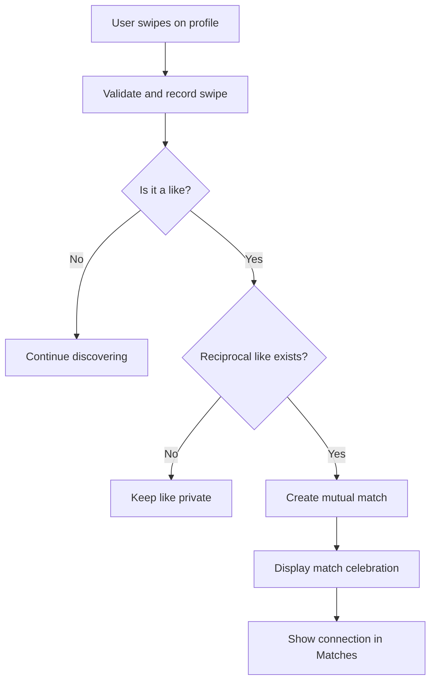
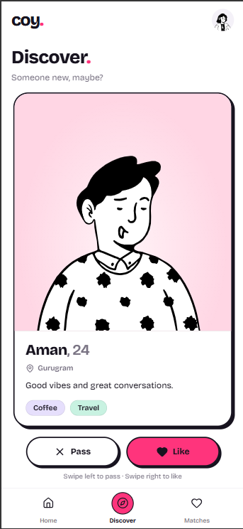
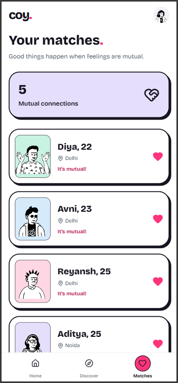

# Coy — Discover & Match

A mobile-first discovery and mutual matching experience built as part of the Coy Software Development Engineer take-home assignment.

The application allows users to discover new people, privately express interest through likes, and form connections only when both users like each other.

## Features

- Mobile-first interface inspired by Coy's existing design language.
- Profile discovery with one profile displayed at a time.
- Swipe right to like and swipe left to pass.
- Alternative Like and Pass buttons.
- Mutual matching with an animated match celebration.
- Dedicated Matches page displaying mutual connections.
- Persistent swipes and matches using SQLite.
- Previously swiped profiles are excluded from the discovery feed.
- Private likes that remain undisclosed until mutual.
- Duplicate swipe protection.
- Loading, error, retry and empty states.
- Responsive layout with persistent bottom navigation.

## Tech Stack

### Frontend

- Next.js
- React
- JavaScript and TypeScript
- Tailwind CSS
- Framer Motion
- Lucide React
- Axios

### Backend

- Node.js
- Express.js
- Sequelize ORM
- SQLite
- Sequelize CLI

## Application Architecture

The application follows a client-server architecture with
independent frontend and backend applications.

```text
Next.js Frontend
       |
       | REST API / Axios
       |
Express.js Backend
       |
       v
Routes
       |
       v
Controllers
       |
       v
Service Layer
       |
       v
Sequelize ORM
       |
       v
SQLite Database
```

The backend follows a modular architecture that separates
request handling, business logic and database operations.

## Project Structure

```text
coy/
├── backend/
│   ├── config/
│   ├── coyDiscover/
│   │   ├── discover.controller.js
│   │   ├── discover.routes.js
│   │   └── discover.service.js
│   ├── database/
│   ├── middlewares/
│   ├── migrations/
│   ├── models/
│   │   ├── user.js
│   │   ├── swipe.js
│   │   └── match.js
│   ├── seeders/
│   ├── utils/
│   ├── app.js
│   └── package.json
│
├── frontend/
│   ├── public/
│   │   └── avatars/
│   ├── src/
│   │   ├── app/
│   │   │   ├── discover/
│   │   │   ├── matches/
│   │   │   ├── globals.css
│   │   │   ├── layout.tsx
│   │   │   └── page.tsx
│   │   ├── components/
│   │   └── lib/
│   └── package.json
│
└── README.md
```

## Database Design

The application uses three core entities.

| Entity | Purpose |
|--------|---------|
| Users | Stores user profiles, interests and avatars |
| Swipes | Records directional likes and passes between users |
| Matches | Stores confirmed mutual connections |

A directional swipe represents an action performed by one
user towards another, while a match represents a mutual
connection between two users.

Separating swipes from matches allows private interests
to remain independent of confirmed connections.

## Mutual Matching Logic

Matching is handled entirely on the backend.

1. A user likes or passes on a profile.
2. The swipe is validated and recorded.
3. If the action is a pass, no match is created.
4. If the action is a like, the backend checks whether
   the target user has previously liked the current user.
5. If a reciprocal like exists, a mutual match is created.
6. The frontend receives the match result and displays
   the match celebration.



Incoming likes are not exposed to the frontend before
a mutual connection is established.

## API Documentation

The Discover module exposes four REST endpoints.

| Method | Endpoint | Description |
|--------|----------|-------------|
| GET | `/me` | Retrieve the current demo user |
| GET | `/feed` | Retrieve eligible discovery profiles |
| POST | `/swipe` | Record a like or pass |
| GET | `/matches` | Retrieve mutual matches |

Endpoint paths are relative to the Discover router's
configured base path.

### Record a Swipe

Request body:

```json
{
  "target_id": 3,
  "action": "like"
}
```

Supported actions:

- `like`
- `pass`

Example response when no mutual match is created:

```json
{
  "success": true,
  "matched": false
}
```

Example response when a mutual match is created:

```json
{
  "success": true,
  "matched": true,
  "match": {
    "id": 1,
    "profile": {
      "id": 3,
      "name": "Ananya",
      "age": 23,
      "city": "Delhi"
    }
  }
}
```

## Local Setup

### Prerequisites

- Node.js 22 or later
- npm
- Git

### 1. Install Backend Dependencies

From the project root:

```bash
cd backend
npm install
```

### 2. Configure Backend Environment

Create a `.env` file inside the backend directory
using the provided `.env.example` as a reference.

```env
PORT=5000
NODE_ENV=development
DEMO_USER_ID=1
```

### 3. Initialize the Database

Run the database migrations:

```bash
npm run db:migrate
```

Populate the database with demo users and incoming likes:

```bash
npm run db:seed
```

The SQLite database is created locally at:

```text
backend/database/coy.sqlite
```

### 4. Start the Backend

```bash
npm run dev
```

### 5. Install Frontend Dependencies

Open another terminal from the project root.

```bash
cd frontend
npm install
```

### 6. Configure Frontend Environment

Create a `.env.local` file using the provided
`.env.example` as a reference.

```env
NEXT_PUBLIC_API_URL=http://localhost:5000
```

### 7. Start the Frontend

```bash
npm run dev
```

Open the application at:

http://localhost:3000

## Demo Experience

The application includes 31 seeded user profiles,
including Alice, the current demo user.

The remaining 30 profiles form the discovery pool.

Selected users have pre-seeded incoming likes to
demonstrate mutual matching without requiring multiple
authenticated accounts.

Reviewers can:

- Explore profiles in the Discover tab.
- Like or pass using gestures or buttons.
- Experience a match when a reciprocal like exists.
- View confirmed connections in the Matches tab.
- Refresh the application to verify data persistence.

## Frontend Validation

The following commands are available for validating
the frontend:

```bash
npm run lint
npm run build
```

To run the production build locally:

```bash
npm run build
npm run start
```

## Technical Decisions

### SQLite

SQLite was chosen to simplify the local setup and
eliminate the need for an external database server.

It provides persistent relational storage while keeping
the assignment easy to run and evaluate.

### Sequelize ORM

Sequelize provides structured database models,
associations, migrations and seeders.

This also makes it easier to migrate to a database
such as PostgreSQL as the application scales.

### Backend-Driven Matching

The backend is responsible for determining whether
a mutual match exists.

This prevents the frontend from needing access to
private incoming likes and keeps matching logic
centralized.

### Framer Motion

Framer Motion is used to provide gesture-based
interactions, swipe transitions and match celebrations.

### Demo User

A predefined demo user is used to simplify the
evaluation process and focus on the discovery and
matching experience rather than authentication.

### Local SVG Avatars

Local SVG illustrations provide consistent profile
visuals without relying on external image services
or real personal photographs.

## Trade-offs and Future Improvements

The current implementation focuses on the core
discovery and mutual matching experience.

For a production application, the following
improvements could be considered:

- Authentication and secure user sessions.
- Paginated discovery feeds.
- PostgreSQL for larger workloads.
- Automated unit and integration tests.
- Rate limiting and abuse prevention.
- Profile preferences and discovery filters.
- Real-time match notifications.
- Profile reporting and blocking.

## Screenshots

### Home


### Discover



### Match Celebration


### Matches



### You are all caught up


### No Matches


## Author

Iqra Rahman

Developed as part of the Coy Software Development
Engineer take-home assignment.

This project is an independent assignment
implementation inspired by Coy.