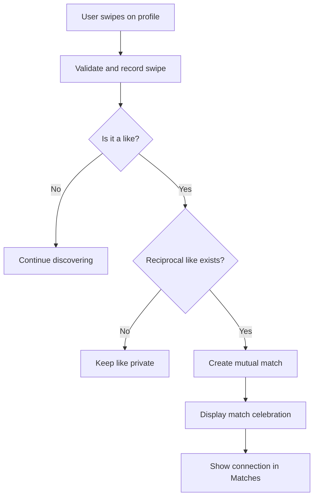
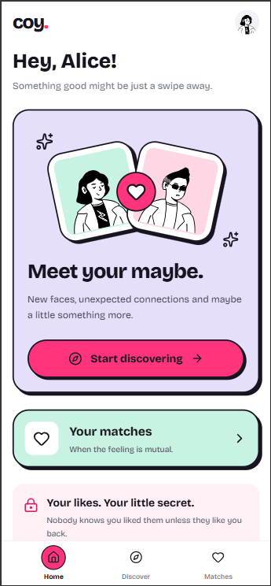
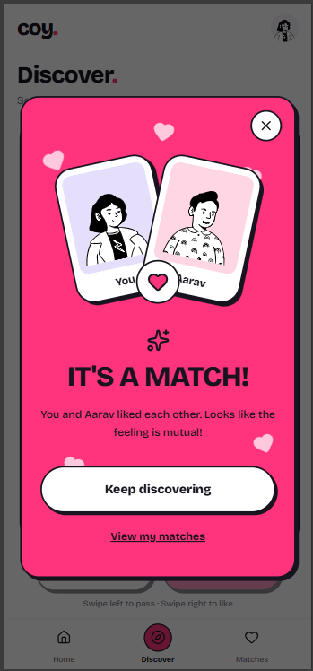
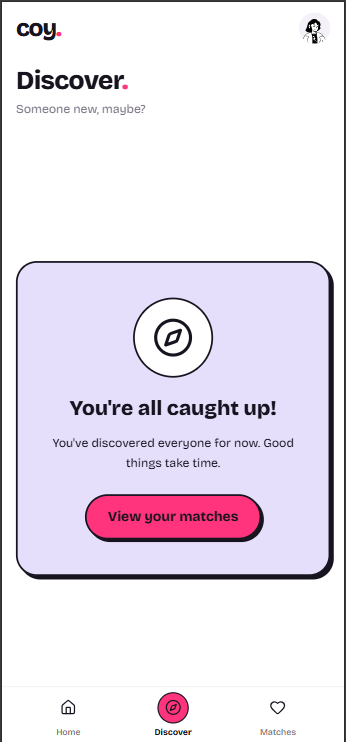
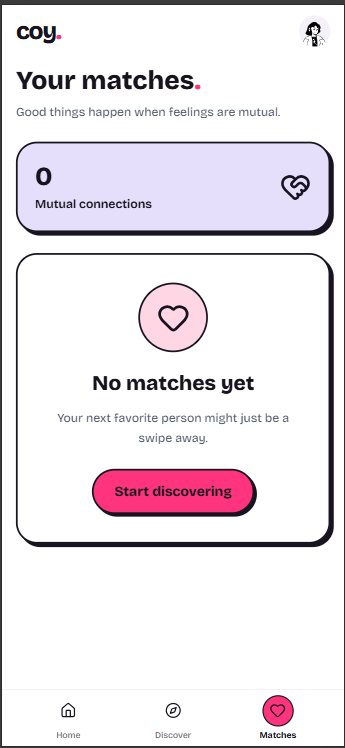

# Coy — Discover & Match

A mobile-first discovery and mutual matching experience built as part of the Coy Software Development Engineer take-home assignment.

The application allows users to discover new people, privately express interest through likes, and form connections only when both users like each other.

## Live Demo

- [Frontend Application](https://coy-discover-tau.vercel.app/)
- [Backend API Health Check](https://coy-backend.onrender.com/health)

The frontend is deployed on Vercel and the backend is hosted on Render.

**Deployment Note:** The backend uses Render's free instance. The initial request may take up to a minute or longer due to a cold start. SQLite data may reset after a server restart or redeployment. Database migrations and seeders run automatically during startup to restore the initial demo data when required.

## Features

- Mobile-first interface inspired by Coy's existing design language.
- Profile discovery with one profile displayed at a time.
- Swipe right to like and swipe left to pass.
- Alternative Like and Pass buttons.
- Mutual matching with an animated match celebration.
- Dedicated Matches page displaying mutual connections.
- Persistent swipes and matches using SQLite.
- Previously swiped profiles are excluded from the discovery feed.
- Private likes that remain undisclosed until mutual.
- Duplicate swipe protection.
- Loading, error, retry and empty states.
- Responsive layout with persistent bottom navigation.

## Tech Stack

### Frontend

- Next.js
- React
- JavaScript and TypeScript
- Tailwind CSS
- Framer Motion
- Lucide React
- Axios

### Backend

- Node.js
- Express.js
- Sequelize ORM
- SQLite
- Sequelize CLI

### Deployment

- Vercel — Frontend
- Render — Backend
- GitHub — Version control

## Application Architecture

The application follows a client-server architecture with independent frontend and backend applications.

```text
Next.js Frontend
       |
       | REST API / Axios
       |
Express.js Backend
       |
       v
     Routes
       |
       v
   Controllers
       |
       v
  Service Layer
       |
       v
  Sequelize ORM
       |
       v
 SQLite Database
```

The backend follows a modular architecture that separates request handling, business logic and database operations.

## Project Structure

```text
coy/
├── backend/
│   ├── config/
│   ├── coyDiscover/
│   │   ├── discover.controller.js
│   │   ├── discover.routes.js
│   │   └── discover.service.js
│   ├── database/
│   ├── middlewares/
│   ├── migrations/
│   ├── models/
│   │   ├── user.js
│   │   ├── swipe.js
│   │   └── match.js
│   ├── seeders/
│   ├── utils/
│   ├── app.js
│   └── package.json
│
├── frontend/
│   ├── public/
│   │   └── avatars/
│   ├── src/
│   │   ├── app/
│   │   │   ├── discover/
│   │   │   ├── matches/
│   │   │   ├── globals.css
│   │   │   ├── layout.tsx
│   │   │   └── page.tsx
│   │   ├── components/
│   │   └── lib/
│   └── package.json
│
├── screenshots/
└── README.md
```

## Database Design

The application uses three core entities.

| Entity | Purpose |
|--------|---------|
| Users | Stores user profiles, interests and avatars |
| Swipes | Records directional likes and passes between users |
| Matches | Stores confirmed mutual connections |

A directional swipe represents an action performed by one user towards another, while a match represents a mutual connection between two users.

Separating swipes from matches allows private interests to remain independent of confirmed connections.

## Mutual Matching Logic

Matching is handled entirely on the backend.

1. A user likes or passes on a profile.
2. The swipe is validated and recorded.
3. If the action is a pass, no match is created.
4. If the action is a like, the backend checks whether the target user has previously liked the current user.
5. If a reciprocal like exists, a mutual match is created.
6. The frontend receives the match result and displays the match celebration.



Incoming likes are not exposed to the frontend before a mutual connection is established.

## API Documentation

**Local Base URL:** `http://localhost:5000`

**Production Base URL:** `https://coy-backend.onrender.com`

| Method | Endpoint | Description |
|--------|----------|-------------|
| GET | `/health` | Check backend service availability |
| GET | `/me` | Retrieve the current demo user |
| GET | `/feed` | Retrieve eligible discovery profiles |
| POST | `/swipe` | Record a like or pass |
| GET | `/matches` | Retrieve mutual matches |

### Record a Swipe

**Endpoint:** `POST /swipe`

Request body:

```json
{
  "target_id": 2,
  "action": "like"
}
```

Supported actions:

- `like`
- `pass`

Example response when no mutual match is created:

```json
{
  "success": true,
  "matched": false
}
```

Illustrative response when a mutual match is created:

```json
{
  "success": true,
  "matched": true,
  "match": {
    "id": 1,
    "profile": {
      "id": 2,
      "name": "Aarav"
    }
  }
}
```

## Local Setup

### Prerequisites

- Node.js 22 or later
- npm
- Git

### 1. Install Backend Dependencies

From the project root:

```bash
cd backend
npm install
```

### 2. Configure Backend Environment

Create a `.env` file inside the backend directory.

```env
PORT=5000
NODE_ENV=development
DEMO_USER_ID=1
```

### 3. Initialize the Database

Run the database migrations:

```bash
mkdir -p database
npm run db:migrate
```

Populate the database with demo users and incoming likes:

```bash
npm run db:seed
```

Run the seed command once against a freshly initialized local database.

The SQLite database is created locally at:

```text
backend/database/coy.sqlite
```

### 4. Start the Backend

```bash
npm run dev
```

The backend runs at:

http://localhost:5000

### 5. Install Frontend Dependencies

Open another terminal from the project root.

```bash
cd frontend
npm install
```

### 6. Configure Frontend Environment

Create a `.env.local` file inside the frontend directory.

```env
NEXT_PUBLIC_API_URL=http://localhost:5000
```

### 7. Start the Frontend

```bash
npm run dev
```

Open the application at:

http://localhost:3000

## Demo Experience

The application includes 31 seeded user profiles, including Alice, the default demo user.

The remaining 30 profiles form the discovery pool. Eight of these users have pre-seeded incoming likes to demonstrate mutual matching without requiring multiple authenticated accounts.

No registration or login is required to explore the demo.

### Testing the Mutual Match Flow

For ease of evaluation, the following profiles have already liked Alice:

| User ID | Profile Name | Expected Result on Liking |
|---------|--------------|---------------------------|
| 2 | Aarav | Mutual match |
| 4 | Rohan | Mutual match |
| 5 | Meera | Mutual match |
| 6 | Kabir | Mutual match |
| 12 | Aditya | Mutual match |
| 18 | Reyansh | Mutual match |
| 23 | Avni | Mutual match |
| 29 | Diya | Mutual match |

All other discovery profiles do not have a pre-seeded incoming like.

### Suggested Testing Scenarios

| Scenario | Action | Expected Result |
|----------|--------|-----------------|
| Mutual match | Like Aarav | Match celebration appears |
| Non-mutual like | Like Ananya | No match; discovery continues |
| Pass | Pass on a profile | Profile is removed from the feed |
| Private incoming like | Pass on a pre-seeded profile | No match is created |
| View matches | Open the Matches tab | Confirmed connections are displayed |
| Persistence | Refresh the application | Previous swipes and matches are retained |
| Empty discovery feed | Swipe on all remaining profiles | Empty state is displayed |
| Empty matches | Open Matches before making a mutual match | No matches state is displayed |

### How to Test a Match

1. Open the Discover tab.
2. Swipe right or press the Like button on any available profile from the pre-seeded list.
3. The animated match celebration will appear.
4. Select View Matches or navigate to the Matches tab.
5. Refresh the page to verify that the connection persists.

The list of pre-seeded incoming likes is documented solely to simplify technical evaluation. Incoming likes remain hidden within the application and discovery API.

**Important:** The hosted demo uses a shared demo account. Previous visitors may have already interacted with some profiles. The expected testing scenarios assume a fresh database, and a fresh local setup is recommended for a complete and independent evaluation.

## Frontend Validation

The following commands are available for validating the frontend:

```bash
npm run lint
npm run build
```

To run the production build locally:

```bash
npm run build
npm run start
```

## Technical Decisions

### SQLite

SQLite was chosen to simplify the local setup and eliminate the need for an external database server.

It provides persistent relational storage while keeping the assignment easy to run and evaluate.

### Sequelize ORM

Sequelize provides structured database models, associations, migrations and seeders.

This also makes it easier to migrate to a database such as PostgreSQL as the application scales.

### Backend-Driven Matching

The backend is responsible for determining whether a mutual match exists.

This prevents the frontend from needing access to private incoming likes and keeps matching logic centralized.

### Modular Backend Architecture

Routes, controllers and services are separated to improve maintainability, readability and separation of concerns.

Business logic is kept within the service layer rather than being tightly coupled with HTTP request handling.

### Framer Motion

Framer Motion is used to provide gesture-based interactions, swipe transitions and match celebrations.

### Demo User

A predefined demo user is used to simplify the evaluation process and focus on the discovery and matching experience rather than authentication.

### Local SVG Avatars

Local SVG illustrations provide consistent profile visuals without relying on external image services or real personal photographs.

### Deployment Strategy

The frontend and backend are deployed independently on Vercel and Render.

Environment-based API configuration allows the frontend to communicate with either the local or deployed backend without changing application code.

## Trade-offs and Future Improvements

The current implementation focuses on the core discovery and mutual matching experience.

### Current Limitations

- The application uses a predefined demo user instead of authenticated user sessions.
- All visitors to the hosted demo share the same discovery and matching state.
- Render's free hosting instance does not provide persistent disk storage.
- Hosted SQLite data may reset when the backend restarts or is redeployed.
- The initial request may experience a delay due to the backend's cold start.

### Future Improvements

For a production application, the following improvements could be considered:

- Authentication and secure user sessions.
- Paginated discovery feeds.
- PostgreSQL for scalable and durable cloud storage.
- Automated unit and integration tests.
- Rate limiting and abuse prevention.
- Profile preferences and discovery filters.
- Real-time match notifications.
- Profile reporting and blocking.

## Screenshots

<p align="center">
  
  
  
</p>

<p align="center">
  <strong>Home · Discover · Match Celebration</strong>
</p>

<p align="center">
  
  
  
</p>

<p align="center">
  <strong>Matches · All Caught Up · No Matches</strong>
</p>

## Author

**Iqra Rahman**

## Copyright

Copyright © 2026 Iqra Rahman. All rights reserved.

This project was developed independently as part of the Coy Software Development Engineer internship assessment.

The source code is provided for recruitment and evaluation purposes only. Commercial use, redistribution, or modification without prior written permission is prohibited.
